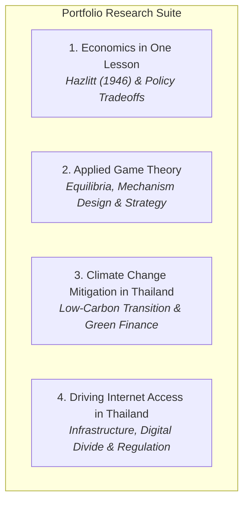
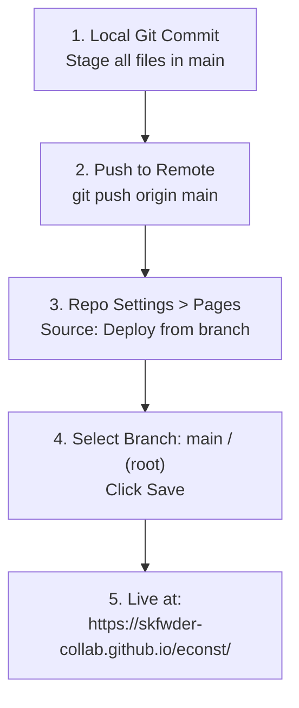

# Economist Portfolio Website: Implementation & Deployment Plan

**Author & Economist**: Songkiat Panmart  
**Contact Email**: `skfwder@gmail.com`  
**Brand Logo**: `black.png`  
**Hero Quote**: *"Master Economics, the Simple Way."*  
**Platform**: GitHub Pages (`https://<username>.github.io/<repo-name>/`)  

---

## 1. Project Overview & Specifications

This plan details the complete end-to-end process to construct, polish, and deploy an academic and strategic portfolio website on GitHub Pages tailored for an economist.

### Core Specifications
| Item | Specification |
| :--- | :--- |
| **Typography** | Google Fonts: **JetBrains Mono** (monospace font tailored for analytical clarity) |
| **Theme / Palette**| Modern Dark Slate (`#090d13` base background, `#121820` surface cards, `#232f3e` border accents, `#58a6ff` primary accent) |
| **Branding** | Minimalist logo using `black.png` with high-contrast framing |
| **Hero Section** | Prominently feature the personal motto: *"Master Economics, the Simple Way."* with clear CTA navigation |
| **About / Contact**| Profile section featuring **Songkiat Panmart**, research interests, and direct email link to `skfwder@gmail.com` with one-click copy helper |
| **Research Projects** | 4 comprehensive, research-grade essays (each **>= 1,000 words**), formatted with executive summaries, theoretical frameworks, data/policy evaluations, and citations |

---

## 2. Information Architecture & Directory Layout

To maintain high page performance and readability, a **multi-page static architecture** is used. The homepage provides an executive overview and project showcase cards, leading into dedicated deep-dive article pages.

```text
my_first_website/
│
├── index.html                           # Homepage (Hero, About Songkiat Panmart, 4 Project Cards, Contact)
├── style.css                            # Unified stylesheet (JetBrains Mono, dark palette, responsive layouts)
├── script.js                            # Navigation logic, reading progress indicators, clipboard utilities
├── black.png                            # Primary logo icon
├── README.md                            # Project documentation & local running instructions
│
├── plan/
│   └── our_plan.md                      # Strategic architectural roadmap & deployment guide
│
└── projects/
    ├── economics-in-one-lesson.html     # Essay 1: Hazlitt's Framework (1,693 words)
    ├── game-theory.html                 # Essay 2: Strategic Interaction & Policy (1,632 words)
    ├── climate-change-thailand.html     # Essay 3: Low-Carbon Transition in Thailand (2,223 words)
    └── internet-access-thailand.html    # Essay 4: Digital Infrastructure & Divide in Thailand (1,879 words)
```

---

## 3. The 4 Research Projects Breakdown (1,000+ Words Each)



### Project 1: Key Economic Concepts of *Economics in One Lesson* (Henry Hazlitt, 1946)
- **Status**: Complete (~1,693 words)
- **Key Modules**:
  1. **The Core Axiom**: Looking not merely at immediate, short-run effects for single groups, but at secondary, long-term consequences for all groups.
  2. **The Broken Window Fallacy**: Frédéric Bastiat’s unseen opportunity cost applied to post-disaster stimulus myths.
  3. **The Mirage of Public Works**: Fiscal reallocation vs. organic capital formation; tax-funded distortion.
  4. **Tariffs and Special Protectionism**: Concentrated benefits vs. diffused burdens on the domestic export base.
  5. **Price Controls & Minimum Wage Mandates**: Artificially fixed prices generating deadweight loss and marginal worker exclusion.
  6. **Inflationary Wealth Dissipation**: Cantillon effect and covert purchasing-power erosion.
  7. **Contemporary Policy Lessons**: Evaluating modern quantitative easing and subsidy programs through Hazlitt's lens.

### Project 2: Game Theory: Strategic Interaction, Equilibrium, and Economic Policy
- **Status**: Complete (~1,632 words)
- **Key Modules**:
  1. **Foundational Axioms**: von Neumann, Morgenstern, and John Nash; strategic forms, rationality, and payoff matrices.
  2. **Simultaneous Play & Nash Equilibrium**: Dominant strategies, Prisoner's Dilemma, and collective action failures.
  3. **Sequential Games & Subgame Perfection**: Extensive-form trees, backward induction, and credible threat credibility.
  4. **Information Asymmetry & Market Signaling**: Akerlof’s adverse selection, Spence’s job-market signaling, and moral hazard.
  5. **Mechanism Design & Auction Theory**: Vickrey-Clarke-Groves (VCG) mechanisms, Dutch/English auctions, and revenue equivalence.
  6. **Macroeconomic & Industrial Applications**: Cartel stability (OPEC), oligopoly pricing (Cournot vs. Bertrand), and central bank forward guidance.

### Project 3: Strategic Management for Climate Change Mitigation and Low-Carbon Transition in Thailand
- **Status**: Complete (~2,223 words)
- **Key Modules**:
  1. **Macroeconomic Context**: Thailand's COP26/COP28 commitments (carbon neutrality by 2050, net-zero GHG emissions by 2065).
  2. **The Bio-Circular-Green (BCG) Economic Model**: Strategic policy framework converting agricultural and manufacturing waste into high-value outputs.
  3. **Market Mechanisms & Carbon Pricing**: Voluntary Emissions Trading Scheme (Thailand V-ETS), Thailand Voluntary Emission Reduction Program (T-VER), and the economic viability of a national carbon tax.
  4. **Power Development Plan (PDP) & Grid Decarbonization**: Renewable energy penetration (solar, biomass), grid modernization, and phasing down coal/gas dependency.
  5. **Industrial Decarbonization & Trade Vulnerabilities**: The EU Carbon Border Adjustment Mechanism (CBAM) impact on Thai exports (steel, cement, aluminum).
  6. **Green Finance & Strategic Recommendations**: Taxonomy for sustainable financing, ESG incentives, and public-private partnership (PPP) structures.

### Project 4: Driving Internet Access in Thailand: Infrastructure, Strategic Opportunities, and Challenges in the Digital Age
- **Status**: Complete (~1,879 words)
- **Key Modules**:
  1. **Infrastructure Landscape**: Fixed broadband penetration vs. mobile broadband adoption; submarine cable gateways and nationwide fiber rollouts.
  2. **The Urban-Rural Digital Divide**: Analysis of regional disparities across Bangkok Metropolitan Region versus northern/northeastern provinces.
  3. **Universal Service Obligation (USO) & Net Pracharat**: Public infrastructure programs, capital expenditure allocation, and municipal Wi-Fi efficiency.
  4. **Market Concentration & Regulatory Dynamics**: NBTC regulatory oversight, merger of True and Dtac, duopoly market structure, and retail pricing pressures.
  5. **Economic Multipliers**: Digital economy expansion, PromptPay / digital wallet adoption, e-commerce growth in MSMEs, and digital labor markets.
  6. **Policy Recommendations**: Spectrum allocation auctions, open-access middle-mile fiber, digital literacy initiatives, and next-gen cross-border data corridor integration.

---

## 4. Design System & User Interface

### Typography
- Google Font: `JetBrains Mono`
- Monospace styling ensures code blocks, mathematical notations, economic equations, and data tables look sharp and legible.

### Color Tokens
```css
:root {
  --bg-primary: #090d13;
  --bg-secondary: #121820;
  --bg-card: #161f2c;
  --border-color: #233144;
  --border-hover: #388bfd;
  --text-primary: #e6edf3;
  --text-muted: #8b949e;
  --accent-cyan: #38bdf8;
  --accent-blue: #58a6ff;
  --accent-green: #3fb950;
  --font-family: 'JetBrains Mono', monospace;
}
```

### Components
1. **Sticky Header**: Includes `black.png` avatar, site identity, navigation links, and quick contact button.
2. **Hero Section**: 
   - Badge containing: *"Master Economics, the Simple Way."*
   - Title: **Songkiat Panmart** — *Economist & Policy Strategist*
   - Action buttons: "Explore Research", "About Me", "Contact".
3. **Research Showcase**: 4 responsive cards featuring tags, excerpt summaries, word counts, and direct links to each full essay.
4. **About & Contact**: Professional bio of Songkiat Panmart, core economic domains, and an email contact button with copy-to-clipboard functionality (`skfwder@gmail.com`).
5. **Article Templates**: Reading progress bar, article metadata (author, reading time, date), structured table of contents, high-readability prose container, and back-to-home navigation.

---

## 5. Step-by-Step GitHub Pages Deployment



### Git Commands
```powershell
# In project root: C:\Data\Onedrive\my_first_website
git add .
git commit -m "feat: complete Songkiat Panmart economist portfolio with 4 research projects"
git branch -M main
git remote add origin https://github.com/skfwder-collab/econst.git
git push -u origin main
```

### GitHub Pages Activation
1. Navigate to **https://github.com/skfwder-collab/econst/settings/pages**.
2. Under **Build and deployment**:
   - **Source**: Select `Deploy from a branch`.
   - **Branch**: Select `main`, folder `/(root)`.
   - Click **Save**.
3. Live site URL:
   ```text
   https://skfwder-collab.github.io/econst/
   ```
