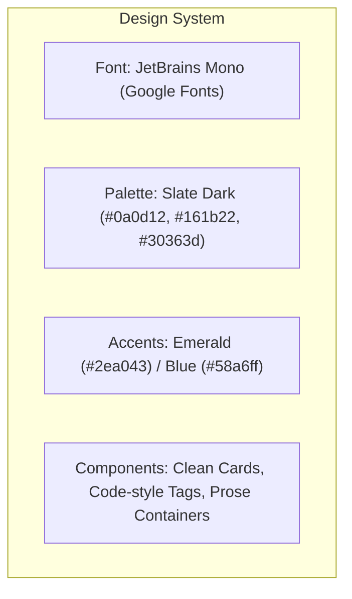
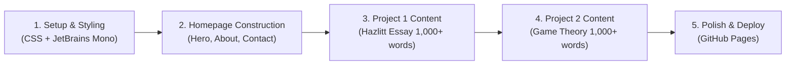

# Economist Portfolio Website: Implementation & Deployment Plan

## 1. Project Overview & Requirements
- **Owner**: Songkiat Panmart
- **Email**: `skfwder@gmail.com`
- **Hero Quote**: *"Master Economics, the Simple Way."*
- **Visual Design**: Sleek modern dark theme (`#0d1117` base, `#161b22` cards, subtle borders `#30363d`), typography powered by **JetBrains Mono**.
- **Branding**: Logo powered by `black.png`.
- **Content Requirements**:
  1. *Economics in One Lesson* (Henry Hazlitt, 1946) โ€” Key economic concepts & modern implications (1,000+ words).
  2. *Game Theory* โ€” Strategic equilibrium, mechanisms, and macroeconomic applications (1,000+ words).
- **Deployment Platform**: GitHub Pages (`https://<username>.github.io/<repository-name>/`).

---

## 2. Architecture & File Structure

A multi-page architecture ensures the 1,000+ word essays have room for clean formatting, mathematical formulas, charts, and citations without cluttering the homepage.

```text
my_first_website/
โ”‚
โ”œโ”€โ”€ plan/
โ”‚   โ””โ”€โ”€ our_plan.md                    # Saved roadmap & design plan
โ”œโ”€โ”€ index.html                         # Homepage: Hero, About Me, Contact, Project Previews
โ”œโ”€โ”€ style.css                          # Global Dark Theme + JetBrains Mono styling
โ”œโ”€โ”€ script.js                          # Smooth scrolling, mobile nav, copy-email helper
โ”œโ”€โ”€ black.png                          # Brand logo asset (with placeholder fallback)
โ”‚
โ”œโ”€โ”€ projects/
โ”‚   โ”œโ”€โ”€ economics-in-one-lesson.html   # Deep-dive essay (1,000+ words)
โ”‚   โ””โ”€โ”€ game-theory.html               # Deep-dive essay (1,000+ words)
โ”‚
โ””โ”€โ”€ README.md                          # Repository documentation & local preview instructions
```

---

## 3. UI/UX & Design System



- **Typography**: Google Fonts `@import url('https://fonts.googleapis.com/css2?family=JetBrains+Mono:ital,wght@0,300;0,400;0,500;0,700;1,400&display=swap');`
- **Dark Palette**:
  - Background: `#090d13`
  - Surface / Cards: `#121820`
  - Border: `#232f3e`
  - Text Primary: `#e6edf3`
  - Text Muted: `#8b949e`
  - Accent / Links: `#58a6ff` and `#3fb950`
- **Header**: Sticky navigation bar with `black.png` logo, Home, Projects, About, and Contact links.

---

## 4. Content Architecture (1,000+ Words Each)

### Project 1: *Key Economic Concepts of Economics in One Lesson (Henry Hazlitt, 1946)*
- **Word Target**: 1,000โ€“1,200 words.
- **Key Modules**:
  1. **The Core Lesson**: Tracing secondary and long-term consequences across all groups rather than immediate effects on special interests.
  2. **The Broken Window Fallacy**: Frรฉdรฉric Bastiat's foundation; unseen destruction vs. seen economic activity.
  3. **The Mirage of Public Works**: Government expenditure as capital reallocation, funded through compulsory taxation rather than net wealth creation.
  4. **Tariffs and Special Interests**: The illusion of domestic protection and the unseen destruction of export industries.
  5. **Price Controls & Minimum Wage**: Shortages, black markets, and marginal productivity disincentives.
  6. **Inflation as Covert Wealth Redistribution**: Cantillon effects, purchasing power dilution, and moral hazard.
  7. **Modern Relevance**: Analysis of Hazlitt's framework in today's stimulus packages and industrial policy.

### Project 2: *Game Theory: Strategic Interaction, Equilibrium, and Economic Policy*
- **Word Target**: 1,000โ€“1,200 words.
- **Key Modules**:
  1. **Foundations**: von Neumann, Morgenstern, and John Nash; defining rational actors, strategies, and payoffs.
  2. **Simultaneous Games & Nash Equilibrium**: Strict dominance, the Prisonerโ€™s Dilemma, and cooperative breakdown.
  3. **Dynamic & Sequential Games**: Extensive form representation, backward induction, subgame perfection, and credible threats.
  4. **Information Asymmetry & Signaling**: Michael Spenceโ€™s signaling model, adverse selection in markets (Akerlofโ€™s Lemons), and moral hazard.
  5. **Mechanism Design & Auctions**: Vickrey auctions, English/Dutch formats, and revenue equivalence theorem.
  6. **Real-World Economic Applications**:
     - Oligopoly competition (Cournot vs. Bertrand).
     - OPEC quota enforcement and cartel stability.
     - Central bank credibility and forward guidance.

---

## 5. Phased Implementation Roadmap



### Phase 1: Global Theme & Base Assets
- Create `style.css` with dark theme variables, JetBrains Mono typography, responsive grid system, and essay-reading typography styles.
- Create initial placeholder for `black.png` to avoid broken image icons until your custom logo is placed.

### Phase 2: Landing Page (`index.html`)
- **Navigation**: Clean header with logo (`black.png`) and smooth-scroll anchors.
- **Hero Section**:
  - Quote: *"Master Economics, the Simple Way."*
  - Subtitle: Economic Research, Classical Principles, and Strategic Modeling by Songkiat Panmart.
  - Call-to-action buttons (`Explore Research`, `Contact`).
- **Featured Research**: Two high-impact cards previewing the two major essays with reading time badges (~5-6 min read).
- **About Me & Contact**:
  - Bio introducing Songkiat Panmart as an economist.
  - Contact card featuring `skfwder@gmail.com` with a one-click copy button and direct `mailto:` link.

### Phase 3: Comprehensive Essay Pages
- Write `projects/economics-in-one-lesson.html` complete with navigation breadcrumbs, callout boxes, and full 1,000+ word essay.
- Write `projects/game-theory.html` with payoff matrix tables, strategic decision trees, and full 1,000+ word essay.

### Phase 4: Interactivity & Polish (`script.js`)
- Copy-to-clipboard functionality for `skfwder@gmail.com` with interactive toast notification.
- Reading progress bar or table-of-contents navigation for the long-form essays.

### Phase 5: GitHub Pages Deployment
- Initialize Git repository and commit all files.
- Push to GitHub repository.
- Enable GitHub Pages from repository settings pointing to root (`/`).

---

## 6. Deployment Instructions (GitHub Pages)

Once files are generated:

```bash
# 1. Initialize local repository
git init
git add .
git commit -m "feat: complete economist portfolio with Hazlitt and Game Theory projects"

# 2. Link to your GitHub repository
git branch -M main
git remote add origin https://github.com/<your-username>/<your-repo-name>.git

# 3. Push to GitHub
git push -u origin main
```

**In GitHub Settings:**
1. Navigate to **Settings** > **Pages**.
2. Under **Build and deployment**, set Source to `Deploy from a branch`.
3. Select branch `main` and directory `/(root)`.
4. Click **Save**. Site will be live at `https://<your-username>.github.io/<your-repo-name>/`.
